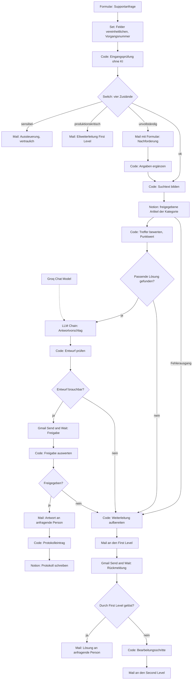

# KI-Assistent für den IT-Service-Desk

Ein n8n-Workflow, der eingehende Supportanfragen prüft, in einer freigegebenen Wissensdatenbank nach einer Lösung sucht, daraus einen Antwortvorschlag formulieren lässt, ihn einem Menschen zur Freigabe vorlegt und erst danach versendet. Was er nicht beantworten kann, leitet er mit Begründung weiter und eskaliert es bei Bedarf. Entstanden als Großprojekt im Rahmen der Weiterbildung zum KI-Integrationsmanager (IHK).

36 Knoten, sieben Abschnitte, vollständige Eskalationslogik.

## Projektziel

Ein IT-Service-Desk beantwortet denselben kleinen Kreis von Fragen immer wieder. Passwort zurücksetzen, Drucker verbindet nicht, Software fehlt, eine Funktion in Microsoft 365 wird gesucht. Die Antworten stehen längst in einer Wissensdatenbank, nur findet sie dort niemand im laufenden Betrieb, und abgetippt werden sie trotzdem jedes Mal neu.

Die naheliegende Lösung wäre ein Chatbot, der einfach antwortet. Genau das soll dieser Workflow nicht. Eine falsche Auskunft aus dem Service-Desk kostet mehr Zeit als gar keine Auskunft, und bei einem Teil der Anfragen wäre sie nicht nur falsch, sondern unzulässig.

Der Workflow ist deshalb um eine andere Frage herum gebaut: **Unter welchen Bedingungen darf ein Sprachmodell überhaupt mitreden, und wer trägt die Entscheidung?** Die Antwort steckt in der Architektur. Das Modell sieht nur Vorgänge, die vorher durch eine Prüfung ohne KI gelaufen sind. Es darf ausschließlich aus einem freigegebenen Wissenseintrag formulieren und muss aufgeben dürfen, wenn der Eintrag nicht passt. Und nichts verlässt das Haus, bevor ein Mensch zugestimmt hat.

Als Pilotumgebung dient die frei erfundene Bergmann Industriekomponenten GmbH. Alle Daten im Projekt sind synthetisch, es gibt keine echten Anfragen und keine personenbezogenen Daten.

## Verwendete Tools

| Baustein | Eingesetzt wofür |
|---|---|
| n8n (lokal in Docker) | Ablaufsteuerung, alle Knoten |
| Formular-Trigger | Eingang der Supportanfrage |
| Set | Vereinheitlichung der Felder, Vorgangsnummer |
| Code-Knoten (JavaScript), 7 Stück | Eingangsprüfung, Suchtext, Trefferbewertung, Entwurfsprüfung, Freigabeauswertung, Protokoll, Eskalationsakte |
| Switch und IF | Verzweigung nach Prüfergebnis und an vier Entscheidungspunkten |
| Notion | Wissensdatenbank und Protokoll |
| Groq, `openai/gpt-oss-120b` | Formulierung des Antwortvorschlags |
| Basic LLM Chain | der einzige Modellaufruf im gesamten Workflow |
| Gmail, Send and Wait | Freigabe und Rückmeldungen als Formular in der Mail |
| Gmail, Senden | Antwort, Weiterleitung, Eskalation, Aussteuerung |

Von 36 Knoten sind zwei KI-Knoten. Das ist kein Versäumnis, sondern das Ergebnis.

## Voraussetzungen

**Zugangsdaten.** Ein Notion-Integrationstoken, ein Groq-Zugang, ein Gmail-OAuth-Zugang. Im Export stehen nur die Verweise, keine Schlüssel und keine Kennungen. Nach dem Import müssen alle drei neu zugeordnet werden.

**Zwei Notion-Datenbanken.**

*IT Support Wissensdatenbank (Pilot)* mit den Eigenschaften Titel, Kennung, Kategorie als Auswahl mit denselben Werten wie das Formular, Stichworte als Mehrfachauswahl, Lösungstext als Text, Prüfdatum als Datum und Status als Auswahl mit mindestens dem Wert `Freigegeben`. Der Workflow liest ausschließlich Einträge mit diesem Status.

*IT Support Protokoll (Pilot)* mit Vorgang als Titel, Zeitpunkt als Datum, Score, Kandidaten und Dauer Minuten als Zahl, Ungeprueft versendet als Kontrollkästchen sowie Kategorie, Standort, Pfad, Artikelkennung, Artikel Pruefdatum, Entscheidung und Freigabekennung als Text.

**Vier Postfächer.** Der Workflow schreibt an eine Freigabeadresse, an den First Level, an den Second Level und an eine Stelle für vertrauliche Vorgänge. Im Export stehen dafür Platzhalter auf `@beispiel-firma.de`, die vor dem ersten Lauf durch eigene Adressen ersetzt werden müssen. Zum Testen genügen vier Plus-Aliasse eines einzigen Postfachs.

**Hinweis zur Veröffentlichung.** Dieser Export ist bereinigt. Mailadressen, Datenbankkennungen, Webhook-Kennungen und Credential-Verweise sind durch Platzhalter ersetzt oder geleert. Der Workflow läuft deshalb nicht ohne eigene Einrichtung, und das ist beabsichtigt.

## Workflow

### 1. Eingang und Prüfung

Ein Webformular nimmt die Anfrage auf: Kategorie, Kurzbeschreibung, Gerätename, Standort, ob die Produktion betroffen ist, eine Fehlerbeschreibung und die Rückmeldeadresse. Ein Set-Knoten vereinheitlicht die Felder und vergibt eine Vorgangsnummer nach dem Muster `VG-20261028-143052`.

Danach läuft die Eingangsprüfung, ein Code-Knoten ohne KI. Sie setzt den Vorgang auf einen von vier Zuständen, und **die Reihenfolge der Prüfungen ist Fachlogik**:

| Reihenfolge | Zustand | Auslöser | Folge |
|---|---|---|---|
| 1 | `sensibel` | einer von 32 Begriffen aus dem Personal-, Gesundheits- oder Hinweisgeberbereich | geht weder an Notion noch an das Modell |
| 2 | `produktionskritisch` | Produktion betroffen | sofort an den First Level, ohne KI |
| 3 | `unvollstaendig` | Gerätename oder Standort fehlt | Nachforderung beim Anfragenden |
| 4 | `ok` | keiner der obigen Fälle | Wissenssuche |

Vertraulichkeit geht vor Eilbedürftigkeit, denn ein vertraulicher Eilfall darf trotzdem nicht ins Modell. Eilbedürftigkeit geht vor Vollständigkeit, denn ein Produktionsstillstand darf nicht in einer Nachforderungsschleife warten. Der Switch hat zusätzlich einen Auffangausgang: ein unerwarteter Wert landet beim Menschen, nicht im Nichts.

### 2. Wissenssuche

Ein Code-Knoten baut aus Kurzbeschreibung, Fehlerbeschreibung und Gerätenamen einen Suchtext, schreibt alles klein, ersetzt Umlaute und entfernt 60 Stoppwörter, die in jeder Supportanfrage vorkommen und deshalb nichts über das Thema aussagen.

Notion liefert daraufhin alle Artikel, die im Status `Freigegeben` stehen **und** zur gewählten Kategorie gehören. Ein weiterer Code-Knoten bewertet sie: Jedes Stichwort eines Artikels, das im Suchtext vorkommt, zählt einen Punkt, jedes Wort aus dem Artikeltitel ab fünf Zeichen zählt einen halben. Der beste Artikel gewinnt, wenn er den Schwellwert erreicht.

Der Schwellwert steht auf 1 und ist die zentrale Stellschraube des Workflows. Zu niedrig bedeutet unpassende Vorschläge, zu hoch bedeutet, dass der Assistent fast nie etwas findet. Er entscheidet damit unmittelbar über die Kennzahl Trefferquote.

### 3. Antwortvorschlag

Erst jetzt kommt das Sprachmodell ins Spiel, und es bekommt einen eng gezogenen Rahmen. Es darf ausschließlich Informationen aus dem gefundenen Wissenseintrag verwenden, nichts aus eigenem Wissen ergänzen, keine zusätzlichen Tipps geben, höchstens 150 Wörter schreiben. Und es hat eine Ausstiegsmöglichkeit: Deckt der Eintrag das geschilderte Problem nicht ab, antwortet es ausschließlich mit `KEIN_ENTWURF`.

Ein Code-Knoten wertet das aus. Damit liegen zwei voneinander unabhängige Filter hintereinander: Der Punktwert prüft, ob ein Artikel inhaltlich nahe genug ist, das Modell prüft, ob sich daraus überhaupt eine Antwort formulieren lässt. Fällt einer von beiden aus, geht der Vorgang an den Menschen.

### 4. Freigabe und Versand

Der Entwurf geht per Gmail Send and Wait an die Freigabeadresse. Die Mail enthält nicht nur den Vorschlag, sondern auch, woher er stammt: Kennung und Titel des Wissenseintrags, dessen letztes Prüfdatum, den erreichten Punktwert und die Stichworte, die getroffen haben. Ohne diese Angaben wäre die Freigabe eine Formalie.

Das Antwortformular in der Mail kennt drei Entscheidungen: freigeben, geändert freigeben oder ablehnen. Bei einer geänderten Fassung gilt der Text der prüfenden Person. Bleibt die Antwort aus, etwa bei Zeitablauf, zählt das als **Ablehnung**. Stillschweigende Freigabe gibt es nicht.

Die versendete Antwort trägt am Ende einen Hinweis, dass sie mit Unterstützung eines KI-Assistenten aus einem genannten Wissenseintrag erstellt und vor dem Versand von einem Menschen geprüft wurde. Die Artikelkennung steht dabei, damit die Quelle nachvollziehbar bleibt.

### 5. Protokoll

Jeder versendete Vorgang wird in Notion protokolliert, und zwar bewusst sparsam. Enthalten sind Vorgangsnummer, Zeitpunkt, Kategorie, Standort, Pfad, Artikelkennung und dessen Prüfdatum, Punktwert, Anzahl geprüfter Kandidaten, die Entscheidung, die Dauer bis zur Freigabe und ein Kennzeichen, dass nichts ungeprüft versendet wurde.

Nicht enthalten sind der Inhalt der Anfrage, der versendete Antworttext und der Klarname der freigebenden Person. Statt des Namens steht eine pseudonyme Freigabekennung. Das Protokoll kann damit belegen, dass geprüft wurde, aber es taugt nicht zur Leistungsüberwachung einzelner Beschäftigter.

### 6. Weiterleitung und Eskalation

Fünf Wege enden ohne versendbare Antwort: kein Treffer, kein Entwurf, abgelehnter Vorschlag, Wissensdatenbank nicht erreichbar und unerwarteter Prüfzustand. Sie laufen alle auf denselben Sammelknoten, der aus dem eintreffenden Datensatz rekonstruiert, welcher Fall vorliegt, und daraus einen verständlichen Grund formuliert. Der First Level erfährt also nicht nur, dass der Assistent nicht helfen konnte, sondern warum.

Nach der Bearbeitung fragt der Workflow per Formular nach: gelöst oder nicht gelöst. Bei gelöst geht die Lösung an die anfragende Person, mit dem ausdrücklichen Hinweis, dass sie ohne Unterstützung des KI-Assistenten erstellt wurde. Bei nicht gelöst baut ein Code-Knoten eine Fallakte aus sechs nummerierten Bearbeitungsschritten und übergibt sie an den Second Level, der damit nicht bei null anfängt.

### 7. Nebenpfade

Vertrauliche Vorgänge gehen an eine gesonderte Stelle, mit Angabe des auslösenden Begriffs und dem Hinweis, dass die Anfrage unverändert im Eingang liegt. Produktionskritische Vorgänge gehen sofort und mit `EILT` im Betreff an den First Level. Unvollständige Anfragen lösen eine Nachforderung beim Anfragenden aus; sobald die Angaben nachgereicht sind, führt ein Code-Knoten sie mit der ursprünglichen Anfrage zusammen und schickt den Vorgang zurück in die Wissenssuche.

## Screenshots

## Herausforderungen

**Die Reihenfolge der Prüfungen war die schwierigste Entscheidung.** Vertraulich, eilig und unvollständig können gleichzeitig zutreffen, und je nach Reihenfolge entsteht ein anderer Fehler. Prüft man Vollständigkeit zuerst, hängt ein Produktionsstillstand in der Nachforderungsschleife. Prüft man Eilbedürftigkeit zuerst, kann ein vertraulicher Eilfall ins Modell geraten. Die gewählte Reihenfolge ist im Code kommentiert, damit sie niemand versehentlich vertauscht.

**Der vorherige Knoten ist nicht die Datenquelle.** Sowohl der Notion-Knoten als auch die LLM Chain geben nur ihr eigenes Ergebnis zurück und verdrängen damit alle Angaben der Anfrage aus dem Datenstrom. An vier Stellen holt der Workflow sie deshalb gezielt über `$('Knotenname')` zurück. Das war der Fehler, der am häufigsten auftrat, weil er sich erst weit hinten im Ablauf als fehlendes Feld zeigt.

**Umlaute müssen auf beiden Seiten gleich behandelt werden.** Anfragende schreiben mal „zurücksetzen" und mal „zuruecksetzen". Die Normalisierung läuft deshalb zweimal, einmal über den Suchtext und einmal über die Stichworte aus Notion. Wird sie nur auf einer Seite angewandt, findet der Abgleich systematisch nichts, und der Fehler sieht aus wie eine schlechte Wissensdatenbank.

**Fünf Zuläufe, ein Sammelknoten.** Alle Wege ohne Antwort münden in denselben Knoten, der aber eine unterschiedliche Begründung erzeugen muss. Gelöst wurde das, indem er aus den vorhandenen Feldern des eintreffenden Datensatzes schließt, welcher Fall vorliegt. Die Prüfreihenfolge dort entspricht der Reihenfolge im Ablauf, von hinten nach vorn.

**Was passiert, wenn niemand antwortet?** Eine Freigabeanfrage, die unbeantwortet bleibt, darf nicht in Zustimmung umschlagen. Der auswertende Code-Knoten setzt deshalb `ablehnen` als Vorgabewert, bevor er die Antwort überhaupt ausliest. Dasselbe gilt für eine leere geänderte Fassung: Der Workflow fällt auf den ursprünglichen Entwurf zurück, statt eine leere Mail zu verschicken.

**Protokollieren heißt entscheiden, was nicht hineinkommt.** Die erste Fassung des Protokolls enthielt Anfragetext, Antworttext und das Freigabepostfach im Klartext. Damit wäre aus dem Nachweis eine Auswertung über einzelne Personen geworden. Die jetzige Fassung belegt das Verfahren, nicht die Beteiligten.

## Lernerfahrungen

**Der KI-Anteil ist der kleinste Teil der Arbeit.** Zwei von 36 Knoten rufen ein Modell auf. Alles andere prüft, verzweigt, führt zusammen, fragt nach und protokolliert. Wer einen KI-Workflow baut, baut vor allem die Umgebung, in der ein Modell arbeiten darf.

**Ein Modell, das aufgeben darf, ist mehr wert als eines, das immer antwortet.** Das Wort `KEIN_ENTWURF` ist die wichtigste Zeile im ganzen Prompt. Ohne sie würde das Modell aus jedem halbwegs ähnlichen Artikel eine plausible Antwort formen, und genau diese Antworten wären die gefährlichen.

**Zwei Filter sind besser als ein guter.** Der regelbasierte Punktwert und die Selbsteinschätzung des Modells prüfen Verschiedenes und versagen auf verschiedene Weise. Hintereinandergeschaltet fangen sie mehr ab, als jeder von beiden allein könnte.

**Eine Freigabe braucht die Quelle, nicht nur den Text.** Ein Vorschlag ohne Angabe, aus welchem Wissenseintrag er stammt und wann dieser zuletzt geprüft wurde, kann nicht sinnvoll geprüft werden. Wer nur den Entwurf sieht, klickt irgendwann auf freigeben.

**Schweigen darf nie Zustimmung sein.** Jeder Pfad, der eine menschliche Entscheidung braucht, muss einen definierten Vorgabewert haben, und dieser Vorgabewert muss die vorsichtigere Variante sein.

**Datensparsamkeit ist eine Entwurfsentscheidung, kein nachträglicher Filter.** Es ist leichter, ein Protokoll von Anfang an so zu bauen, dass es nur Verfahrensdaten enthält, als es später zu bereinigen.

**Ausschließen ist auch eine Funktion.** Der Workflow wirkt an den Stellen am stärksten, an denen er bewusst nichts tut: bei vertraulichen Vorgängen, bei Produktionsstillstand und bei fehlendem Treffer. Ein Assistent, der seine eigenen Grenzen kennt, lässt sich in einem Unternehmen einführen. Einer, der alles beantwortet, nicht.
